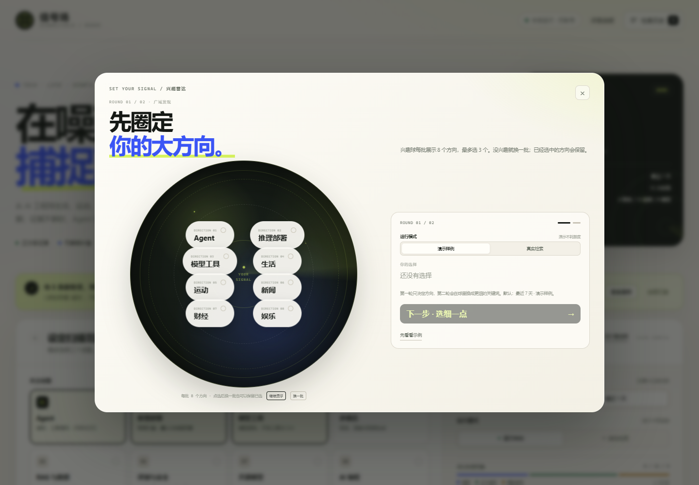
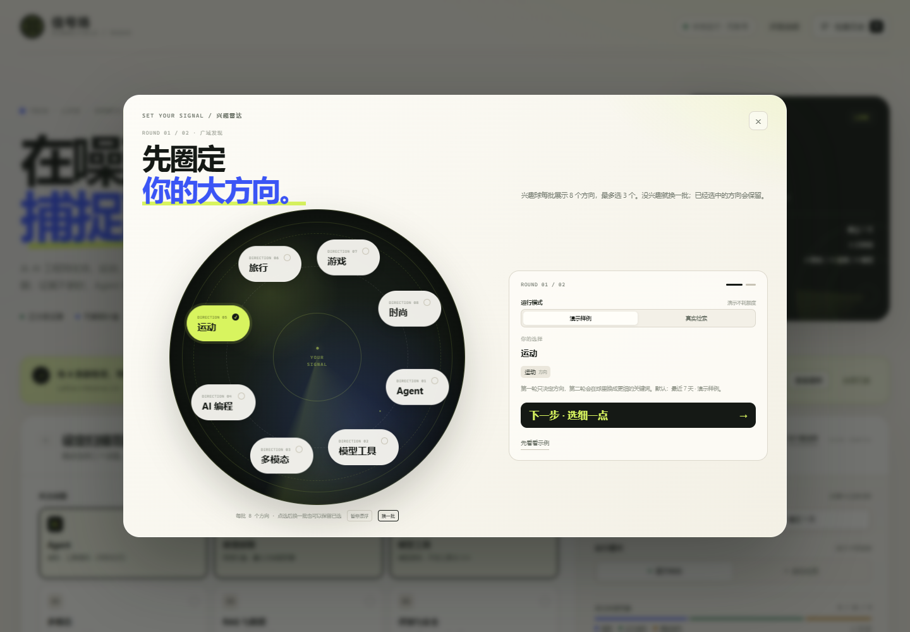
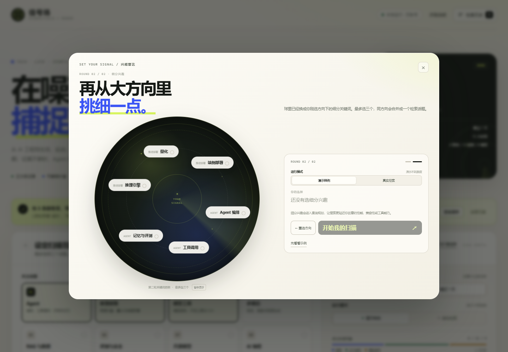
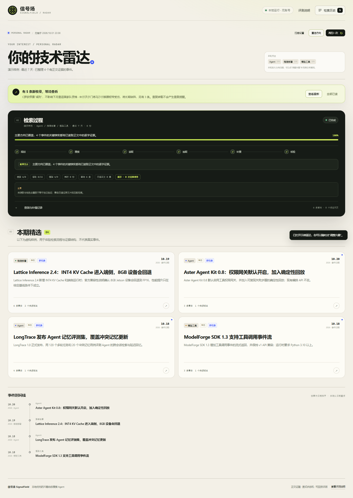
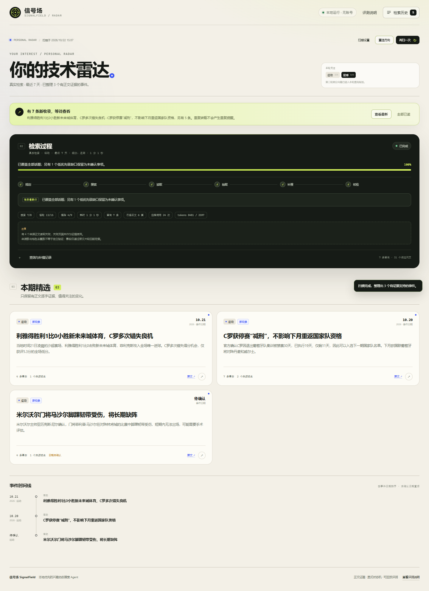
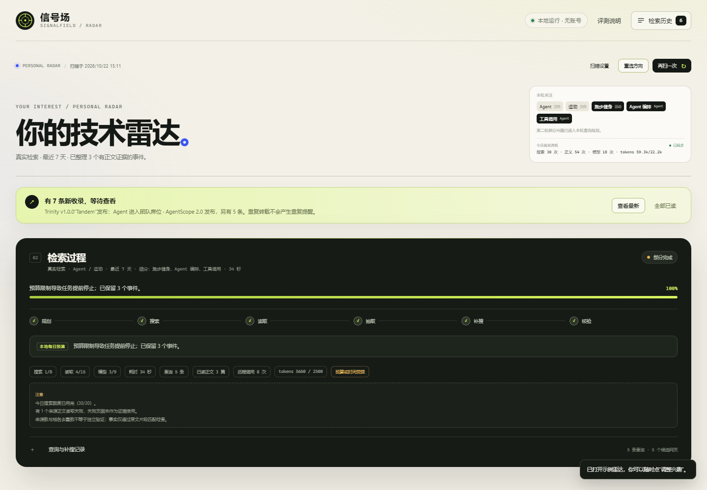
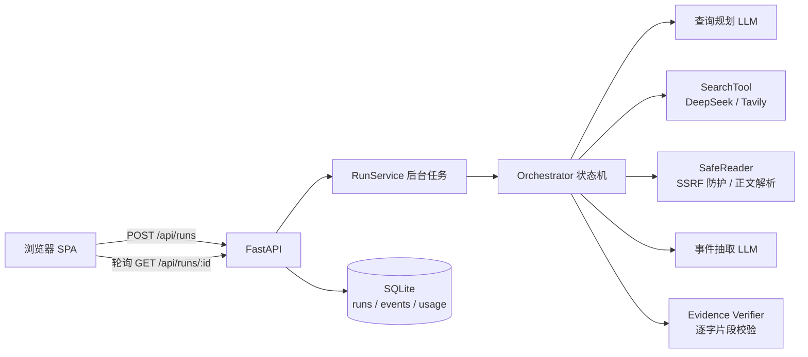
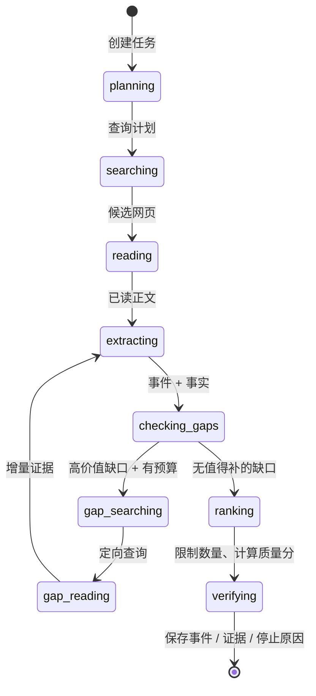

# 信号场 SignalField

一个可本地试用的通用兴趣动态搜索 Agent：覆盖 **技术、生活、运动、新闻、财经、娱乐、科学、健康、汽车、旅行、教育、游戏、时尚** 等 20 个方向，在最近 1 / 7 天内执行「规划 → 搜索 → 读正文 → 聚合事件 → 证据核验 → 缺口补搜 → 排序保存」的完整闭环。

项目重点不是聊天，而是展示 **搜索策略、工具调用、证据处理、补搜决策和效果评测**。默认演示不依赖任何密钥；真实检索支持 **DeepSeek Search** 或 **Tavily**，并接入任意 OpenAI-compatible `chat/completions` 模型。

**技术栈：** Python 3.11+ · FastAPI · SQLite · httpx · Pydantic v2 · 原生 HTML/CSS/JS · Playwright · GitHub Actions

**工程亮点**

- 显式状态机 + 阶段迁移历史、可取消后台任务、重启恢复、单任务预算，以及实时今日调用量。
- 两轮动态兴趣球：20 个大方向池，首轮每批展示 8 个，可“换一批”；每个方向 3 个细分关键词，漂浮碰撞、可暂停。
- Tavily / DeepSeek Search 可切换适配器；DeepSeek 搜索与模型共用一把 Key。
- 每条事实绑定实际读取正文中的逐字 quote；程序做来源存在与片段匹配校验，不夸大语义验证。
- 缺口驱动的补搜与停止策略，保留 `partial / cancelled / budget` 等真实结果状态。
- A/B/C 固定材料回放、人工标注模板、45 项自动化测试与真实联网试跑记录。

> 当前状态：**DeepSeek Search + deepseek-flash 已完成多次真实联网试跑，覆盖技术与通用领域**。最近一次（运动 / 足球）：7 次搜索、13 次正文读取尝试、4 次模型调用、3 个事件、16 个逐字证据片段全部通过程序匹配，最终 `completed`，保留 1 个低优先级日期缺口。这是功能验收，不构成带人工标注的效果评测。

**首次打开是独立的兴趣选择页，不是一屏到底的长页面。** 关键词会像圆球里的粒子一样弹入、漂浮和碰撞；可以随时暂停。选完两轮后自动切换到“你的技术雷达”结果页。

第一轮从 20 个方向池里展示 8 个大方向，不感兴趣可以换一批（已选方向会保留）：



换一批后，已选的运动方向仍然保留：



第二轮换成更细的关键词（同方向最多三个，自动合并检索话题）：



完成后自动进入第二页——只展示本轮扫描和事件证据，不把首页设置和结果堆在一起：



真实模式的事件卡片直接提供 **“原文 ↗”**，详情页提供 **“查看原网页”**：



发布版还在雷达页实时显示今日真实调用量，不设每日总额度上限：



## 快速开始

要求 Python 3.11+（本机使用 3.13.2 测试），Windows / macOS / Linux 均可。演示模式完全免费；真实模式按搜索服务与模型服务商计费。

```bash
git clone https://github.com/<your-account>/ai_search.git
cd ai_search
```

目录名可以按你的仓库名调整；下面默认使用 `ai_search`。

### Windows（推荐）

```powershell
cd ai_search
powershell -ExecutionPolicy Bypass -File .\start.ps1
```

首次运行会创建 `.venv`、安装依赖、从 `.env.example` 复制 `.env`（密钥为空），然后启动：

**http://127.0.0.1:8790**

### 手动启动

```powershell
cd ai_search
python -m venv .venv
.\.venv\Scripts\Activate.ps1
pip install -r requirements.txt
Copy-Item .env.example .env
python -m app
```

Linux / macOS：

```bash
cd ai_search
python3 -m venv .venv
.venv/bin/pip install -r requirements.txt
cp .env.example .env
.venv/bin/python -m app
```

打开 **http://127.0.0.1:8790**。首次进入是一个独立的兴趣球页面：

1. **第一轮 · 广域**：在漂浮的球里选择大方向，每次展示 8 个、最多选 3 个。内置 20 个方向，包含 Agent、推理部署、模型工具、多模态等技术方向，也包含生活、运动、新闻、财经、娱乐、科学、健康、汽车、旅行、教育、游戏、时尚。不感兴趣就点“换一批”，已选方向会保留。
2. **第二轮 · 细分**：球里的标签自动换成对应方向的细分关键词，每个方向 3 个（例如 Agent 编排 / 工具调用 / 记忆与评测，量化 / 端侧部署 / 推理引擎），最多选三个。
3. 弹窗内可切换演示 / 真实模式；真实模式会把两轮兴趣作为 `focus_keywords` 交给查询规划。
4. 点“开始我的扫描”后**自动跳转到第二页“你的技术雷达”**，并立即开始后台检索；首页设置和结果不再挤在同一个长页面。

也可以“先看看示例”直接浏览默认的 4 个虚构事件。兴趣选择支持鼠标悬停暂停、按钮暂停，以及刷新后记住上一轮选择。

> 服务只监听 `127.0.0.1`，不做公网部署。若端口被占用，可设置 `SIGNALFIELD_PORT=8791` 或 `python -m app --port 8791`。

## 演示体验

- **演示模式**：使用虚构项目与保留 `.invalid` 域名，明确标注“虚构样例”；不执行实时搜索、不消耗远程额度，日期为相对样例日期。演示语料覆盖前三个方向；新方向请在兴趣弹窗内切换真实模式。
- **真实模式**：必须配置服务端密钥。缺失配置时前端和 API 都会明确报错，**不会静默返回演示数据**。
- **原文跳转**：真实模式的事件卡片提供“原文 ↗”，详情页提供“查看原网页”，同时保留完整来源列表；演示来源不可访问，不生成外链。
- 最多选择 3 个话题，时间范围为最近 24 小时或最近 7 天；两轮兴趣关键词会作为 `focus_keywords` 进入查询规划。
- 视图分层：兴趣选择页 → 雷达结果页 → 设置页，各自独立；兴趣选完自动进入雷达页，不在一个长页面里从上滑到底。
- 返回路径：雷达页顶部和结果区都有“重选方向”，回到第一轮重新选择；从雷达页打开兴趣选择后，也可用“返回当前雷达”取消，不丢当前结果。
- 原文链路：事件卡片直接提供“原文 ↗”，详情页有“查看原网页”主按钮，来源列表继续保留多来源链接。
- 每次运行都会显示：阶段进度、当前动作、查询目的、补搜原因、调用/预算、停止原因；真实模式还会实时显示今日真实调用量（搜索 / 正文 / 模型 / tokens），但不设每日上限。
- 默认只保留少量高价值事件，不为填满页面生成内容。

演示页支持：话题多选与自定义、演示/真实切换、进度与查询记录、事件卡片、证据详情、事件时间线、检索历史、已读/更新提示、取消、无结果、部分失败和额度耗尽反馈。

## 真实服务配置

当前项目选择 **DeepSeek Search**：搜索和大模型共用 `LLM_API_KEY`，不需要 Tavily Key。编辑项目根目录 `.env`（不要提交到 Git），只需填 Key：

```dotenv
SEARCH_PROVIDER=deepseek
LLM_BASE_URL=https://api.deepseek.com
LLM_API_KEY=你的 DeepSeek Key
LLM_MODEL=deepseek-flash
LLM_JSON_MODE=true
LLM_THINKING=disabled
```

- DeepSeek Search 使用 `POST https://api.deepseek.com/v1/tools/search`，与模型共用账户余额；价格约为每 1,000 次成功搜索 ¥5，以[官方文档](https://api-docs.deepseek.com/zh-cn/guides/search)为准。
- 项目把时间窗和域名约束转换成 DeepSeek 的 `after:` 与 `site:` 查询语法；正文仍由项目自己读取和校验。
- 模型需要支持 JSON 输出。DeepSeek 支持 `response_format={"type":"json_object"}`；若换其他供应商且不支持，设置 `LLM_JSON_MODE=false`。
- `LLM_THINKING=disabled` 是 DeepSeek 专用参数，用于降低结构化抽取的延迟与 token；换供应商时留空。
- 官方参考：[DeepSeek 首次调用 API](https://api-docs.deepseek.com/)、[DeepSeek JSON Output](https://api-docs.deepseek.com/zh-cn/guides/json_mode/)、[DeepSeek Search](https://api-docs.deepseek.com/zh-cn/guides/search)。
- 密钥只从服务端环境变量或本地 `.env` 读取，不写入浏览器、不打印、不提交。
- 修改 `.env` 后重启服务，再在界面切换到“真实检索”。

如果想改回 **Tavily**，只需：

```dotenv
SEARCH_PROVIDER=tavily
TAVILY_API_KEY=tvly-...
```

Tavily 免费每月 1,000 credits，`basic` 搜索 1 credit/次；超出后按其[官方计费](https://docs.tavily.com/documentation/api-credits.md)付费。两种 provider 都走同一个 `SearchTool` 接口，页面读取、证据校验和预算逻辑不变。

真实模式的设计约束：

- 搜索结果摘要仅用于发现线索，不作为事实证据；服务商直接生成的答案不进入流程。
- 只读取以 `http/https` 开头的公网页面；本机、内网、保留地址和带凭据 URL 会被拒绝。
- 页面正文按纯文本处理，不执行脚本；网页中的指令不会控制 Agent。
- 搜索、正文读取和模型调用分别计预算；失败与部分结果会保留并明确展示。

## 系统结构



## 检索策略

不是把所有网页丢给模型，而是让程序控制搜索边界、读取成本和补搜条件：

| 阶段 | 策略 |
|---|---|
| 初始规划 | 按话题 + 两轮兴趣 + 时间窗生成中英文查询；技术方向偏向官方 release notes，通用方向偏向权威媒体和一手公告 |
| 候选过滤 | 统一 URL、去重、截断超长结果；搜索摘要只做线索，不进入事实 |
| 正文读取 | 每个任务最多读取 15 次，初始最多 9 篇；失败页面保留状态但不作为证据 |
| 事件抽取 | 将文档聚合为事件，事实必须携带来源 ID 和逐字 quote；日期、条件、冲突分开建模 |
| 缺口补搜 | 只在日期不明、缺原始来源、性能条件不足、来源冲突、话题无结果等高价值缺口上补搜，最多 2 轮 |
| 停止 | 覆盖充分、低价值缺口、无结果、读取失败、补搜轮次用尽、单任务预算/时间、用户取消、服务不可用等均保留部分结果 |
| 发布 | 程序校验引用片段、去重、合并转载、按证据完整度排序，只保留少量事件 |

## 工作流与状态机



停止原因包括：覆盖充分、低价值缺口、无结果、无可核验事件、正文读取失败、补搜轮次用尽、证据缺口未解决、单任务预算耗尽（每日上限如手动开启也可能触发）、超时、用户取消、服务不可用、配置缺失。

状态不是聊天记录。每次运行在 SQLite 中保存：

- `runs.state_json`：显式状态快照（话题、窗口、阶段、阶段迁移历史、查询计划、候选文档、事件、事实、证据、缺口、补搜动作、预算、停止原因）；阶段图边在 `app/state.py` 的 `STAGE_TRANSITIONS` 中显式声明；
- `events`：用于历史、已读和事件更新判断；
- `usage`：按天记录真实远程调用；演示调用单独标记为 `simulated=1`，不计入真实用量。

可恢复性：服务启动时会把上次异常中断的 `queued/running/cancelling` 任务标记为部分完成或已取消，保留已保存结果，不会假装继续运行。完整正文只在内存中使用，落盘只保留短摘录、来源元数据和逐字证据片段。

## 预算与停止

默认单任务硬预算（可在 `.env` 调整）：

| 项目 | 默认上限 |
|---|---:|
| 搜索 | 8 次 |
| 正文读取尝试 | 15 次 |
| 模型调用 | 9 次 |
| 补搜轮次 | 2 轮 |
| 总耗时 | 120 秒 |

每日上限默认关闭（`DAILY_*_BUDGET=0`），但按天记录真实调用并在界面实时展示。单任务仍有搜索 8、读取 15、模型 9、120 秒的硬上限；时间、用户取消和服务商错误都会在工具边界处停止，并尽量保留有效的部分结果。若需要兜底，可把 `DAILY_*` 设为正整数重新启用每日上限。

补搜必须关联明确缺口，例如：日期不明、只有转载没有原始发布、性能结论缺硬件/基线/负载、来源冲突、某话题无有效结果。每次补搜记录：原因、查询、是否新增事件/事实、是否解决缺口、结果是否有效。补搜没有新增价值时会提前停止，不为了“多刷几轮”继续消耗。

## 证据与质量设计

区分三层：

- **文档**：一篇实际读取的文章/公告，记录 URL、域名、文章发布时间、抓取时间、读取状态。
- **事件**：某个项目的一次发布、更新或变化；同一事件的多篇转载会合并。
- **事实**：具体陈述，必须关联实际读取文档中的逐字片段。

关键处理：

1. **日期分层**：事件日期、文章发布时间、抓取时间分开保留；无法确认时标记“日期待确认”，不把文章日期包装成事件日期。
2. **片段校验**：事实进入卡片前，程序检查来源存在且 quote 在已读取正文中；只做空白/全半角归一化，不改写语义。
3. **不夸大验证**：引用支持率只代表“片段逐字匹配”，不代表语义正确或独立来源验证；UI 中明确写出这一点。
4. **转载去重**：canonical URL、正文哈希和近似重复检测；域名去重用于显示来源数，但页面明确说明它不等于独立确认。
5. **性能条件**：性能类事实缺硬件/基线/负载时进入缺口与未确认事项。
6. **来源冲突**：保留在“未确认事项”，直到补搜原始资料解释；程序不强行做确定结论。
7. **模型理由分离**：来源事实和“关注理由（模型生成）”在详情中分开展示。
8. **事件更新**：以稳定 `event_key` + 已支持事实指纹比较历史；只有新增实质事实或补齐日期才产生未读更新，重复转载不重复提醒。

## 评测

### A/B/C 固定材料回放（零密钥可运行）

```powershell
.\.venv\Scripts\python.exe -m evaluation.run_replay
```

三个策略线：

| 策略 | 行为 |
|---|---|
| A | 单次搜索、最多 2 篇正文、无补搜 |
| B | 与 C 相同的搜索/读取/模型预算，固定查询链，无补搜 |
| C | 同预算，根据日期/条件/冲突/读取失败等证据缺口定向补搜 |

覆盖 8 个固定场景：正常发布、重复转载、旧文重发、日期模糊、性能缺条件、来源冲突、无结果、正文读取失败。

**最近一次实测（合成开发集；不是线上效果）**：

| 策略 | 参考事件覆盖 | 参考事实覆盖 | 时间符合 | 引用支持率 | 事件重复率 | 平均搜索/读取/模型 |
|---|---:|---:|---:|---:|---:|---:|
| A 单次搜索 | 83.3% | 58.3% | 80.0% | 100.0% | 0.0% | 1.0 / 1.25 / 2.38 |
| B 固定查询 | 83.3% | 58.3% | 80.0% | 100.0% | 0.0% | 2.0 / 1.38 / 2.38 |
| C 缺口自适应 | 100.0% | 100.0% | 100.0% | 100.0% | 0.0% | 2.75 / 1.88 / 2.88 |

完整报告：`evaluation/results/replay_latest.md`，原始数据：`evaluation/results/replay_latest.json`，人工标注批次：`evaluation/results/annotation_batch.csv`。

**必须同时阅读**：

- 抽取器是确定性测试替身，不是远程 LLM；搜索也是固定材料回放。这个评测隔离的是检索策略与工程闭环，不测模型能力。
- 8 个案例是开发集而非留出集，C 的满分只说明它解决这些已设计缺口，不代表泛化。
- 引用支持率只校验逐字片段，不是语义支持或独立信源确认。
- 人工相关性、独立确认与变更判断仍需要按 `evaluation/annotation_guide.md` 标注，自动指标不能替代人评。

### 实时评测（与回放严格分开）

先启动本地服务并配置真实密钥，再运行：

```powershell
.\.venv\Scripts\python.exe -m evaluation.run_live --confirm-live --topic "Agent" --window week
```

脚本会明确提示真实额度消耗、要求 `--confirm-live`，保存带时间戳的 `evaluation/results/live_*.json`，不生成无法验证的自动“标准答案”，也不与回放结果合并。

## 测试与验收

```powershell
.\.venv\Scripts\python.exe -m pip install -r requirements-dev.txt
.\.venv\Scripts\python.exe -m pytest -q
```

GitHub Actions 工作流位于 `.github/workflows/tests.yml`，在每次 push / pull request 时运行测试和 A/B/C 回放（不发送任何密钥）。`requirements-dev.txt` 还包含 Playwright，供浏览器冒烟检查使用。

当前结果：**45 passed**。覆盖：

- 话题/输入校验、日期解析
- SSRF / 本机地址拦截、URL canonicalization
- 引用片段匹配、近似转载去重、事件合并、窗口边界
- 单任务预算、实时用量统计、token 成本估算
- 演示完整闭环、单话题、自定义话题无结果
- mock Tavily / mock DeepSeek Search / mock OpenAI-compatible 适配器、正文解析、私网重定向拦截
- 模型鉴权失败时在搜索前停止，不消耗搜索额度、不静默降级
- 正文读取失败、模型编造引用不进入事实
- SQLite 事件更新分类、已读、重启中断处理
- API 配置不泄露密钥、运行/取消/已读/历史
- A/B/C 回放评测入口

浏览器检查（Edge，Playwright，无浏览器下载）：

```powershell
# 服务已在 8790 运行时
.\.venv\Scripts\python.exe scripts\browser_smoke.py
```

检查两轮兴趣球（暂停后点选）、大方向 → 细分的切换、自动进入雷达页、事件详情、逐字证据、无真实外链的演示来源、查询记录、历史抽屉、真实模式缺配置报错、移动端无横向溢出，并生成 `docs/interest.png`、`docs/interest-round2.png`、`docs/radar.png`、`docs/home.png`、`docs/detail.png`、`docs/mobile.png`。

兴趣选择还经过独立浏览器测试：选择“工具调用 + 量化”后会自动跳转到雷达页、发起两个方向的扫描，并把 `focus_keywords` 写入运行状态；刷新后不再重复弹出。兴趣球支持悬停暂停和按钮暂停，避免运动目标难以点击。

本机最近一次结果：`ok: true`，兴趣球支持“换一批”且保留已选方向；真实模式 3 张运动类事件卡片，卡片“原文 ↗”和详情“查看原网页”均可打开，0 个 console/page error，0 个失败请求，移动端无横向溢出。截图见 `docs/`（含 `interest-shuffled.png`、`live-radar.png`、`live-detail.png`）。

## 工程结构与关键取舍

```
app/
  main.py            FastAPI + 路由 + 安全头
  config.py          环境变量与配置
  db.py              SQLite 持久化、事件更新、调用记录
  state.py           显式运行状态与公开视图
  budgets.py         单任务预算、可选每日上限、预留式计数
  security.py        URL/内网地址校验
  demo.py            虚构演示语料与确定性演示适配器
  pipeline/
    orchestrator.py  搜索-读取-抽取-缺口-补搜状态机
    evidence.py      引用校验、去重、合并、排序
  tools/             search_web / read_pages 适配层
  llm/               OpenAI-compatible 客户端与提示词
  services/runs.py   后台任务、取消、演示种子
  static/            原生 HTML/CSS/JS 中文界面
evaluation/          A/B/C 回放、实时评测、标注模板
tests/               45 项自动化测试
scripts/             Playwright 浏览器检查
```

关键取舍：

- **不用聊天消息保存任务状态**：显式状态快照更适合重试、取消、预算和审计。
- **FastAPI + 原生前端 + SQLite**：单机低运维、无构建链；代价是没做前端组件化与多进程支持。
- **ThreadPoolExecutor 后台任务**：足够本地单实例；不引入 Redis/Celery。
- **适配层而非绑定框架**：DeepSeek Search / Tavily / 模型 / 页面读取均可替换；第一版不引入 LangChain 等重依赖。
- **程序校验 + 模型生成分工**：模型负责语义整理与补搜建议，程序负责参数、URL、引用片段、预算和状态。
- **确定性演示**：没有密钥也能完整验收；演示标记与真实模式严格隔离。
- **两轮兴趣球**：第一轮只圈定广域方向，第二轮才出现细分关键词；标签带轻量碰撞与漂浮动画，悬停或按钮暂停后仍可稳定点选。
- **视图切换而非单页堆叠**：兴趣页只负责选择，雷达页只负责结果，扫描设置单独成为一页；完成后以过渡动画进入雷达页。

## 已知限制

1. **真实功能已试跑，但效果尚未做人工标注评测**：2026-10-22 已完成多次单话题 DeepSeek Search + deepseek-flash 的真实扫描，覆盖技术、多模态与运动方向，验证了调用、预算停止和证据闭合；结果未经过独立人工相关性、时间符合度和事实支持度标注，不能当作线上质量结论。试跑中还观察到同一篇文章中的多个事件方面偶尔会被拆成多张卡片，说明事件聚合仍有改进空间。
2. 只提取静态 HTML；依赖 JavaScript 渲染的页面可能读取失败并记录为失败，不会退化为摘要证据。
3. SSRF 防护在请求和每次重定向前做 DNS 解析与 IP 检查；对 DNS rebinding 的完全防御需要网络层出口控制，本地版本未提供该隔离。
4. 引用校验是字符串匹配，语义支持仍需人工判断；多篇转载并不等于独立证据。
5. 单进程 SQLite + 内存任务协调，不适合多实例或公网多用户；未做登录、权限、推送和公网部署。
6. 取消在工具边界生效，正在进行的单个 HTTP 请求可能到超时才返回；总时长仍受 120 秒任务上限约束。
7. 模型输出 JSON 结构不支持时，任务会明确失败或保留部分结果；不会伪造事件。
8. 演示内容是虚构样例，来源域名为保留 `.invalid`，不可访问，日期不代表真实事件日期。
9. 每日上限默认关闭；页面上的“今日真实消耗”是本地应用计数，不是服务商账单或余额。真实费用以搜索服务 / 模型服务商账单为准。
10. 只保存来源元数据、短摘录与证据片段，不长期缓存完整正文；使用搜索结果和页面内容时仍需遵守来源与服务商条款。

## 配置参考

所有变量和默认值见 `.env.example`。常用项：

| 变量 | 说明 |
|---|---|
| `SIGNALFIELD_HOST` / `SIGNALFIELD_PORT` | 监听地址/端口，默认 `127.0.0.1:8790` |
| `SIGNALFIELD_DB_PATH` | SQLite 路径 |
| `SIGNALFIELD_SEED_DEMO` | 首次启动是否生成演示历史 |
| `MAX_SEARCHES` / `MAX_READS` / `MAX_MODEL_CALLS` / `MAX_GAP_ROUNDS` / `MAX_SECONDS` | 单任务预算 |
| `DAILY_SEARCH_BUDGET` / `DAILY_READ_BUDGET` / `DAILY_MODEL_BUDGET` | 可选每日上限；`0` 表示不限，用量仍会统计 |
| `SEARCH_PROVIDER` | `deepseek`（本项目当前选择）或 `tavily` |
| `TAVILY_API_KEY` | 仅当 `SEARCH_PROVIDER=tavily` 时需要 |
| `LLM_BASE_URL` / `LLM_API_KEY` / `LLM_MODEL` | DeepSeek Search 与大模型共用；已预填 base URL 与 `deepseek-flash` |
| `LLM_JSON_MODE` | 供应商不支持 JSON mode 时设为 false |
| `LLM_THINKING` | DeepSeek 专用可选值 `enabled`/`disabled`；其他供应商留空 |
| `TAVILY_COST_PER_CALL_USD` / `LLM_*_PRICE_PER_MTOK_USD` | 可选的本地费用估算，0 表示不估算 |

## 数据与安全

- 服务仅绑定本机，不主动上传数据库；浏览器与 API 同源。
- 密钥不进入状态快照、事件、日志或前端；API 只返回缺失变量名，不返回值。
- CSP、`X-Content-Type-Options`、`X-Frame-Options`、`Referrer-Policy` 已设置。
- 所有用户/来源文本以 `textContent` 渲染，不拼接未转义 HTML。
- 数据库使用参数化 SQL；任务 ID 通过路径参数查询，不使用文件系统路径。
- 演示来源不生成可点击的真实链接。
- 安全边界与报告方式见 [`SECURITY.md`](SECURITY.md)。

如果要在团队环境试用，请先增加认证、TLS/反向代理、真正的网络出口限制和按用户的配额，不要直接把当前版本暴露到公网。
